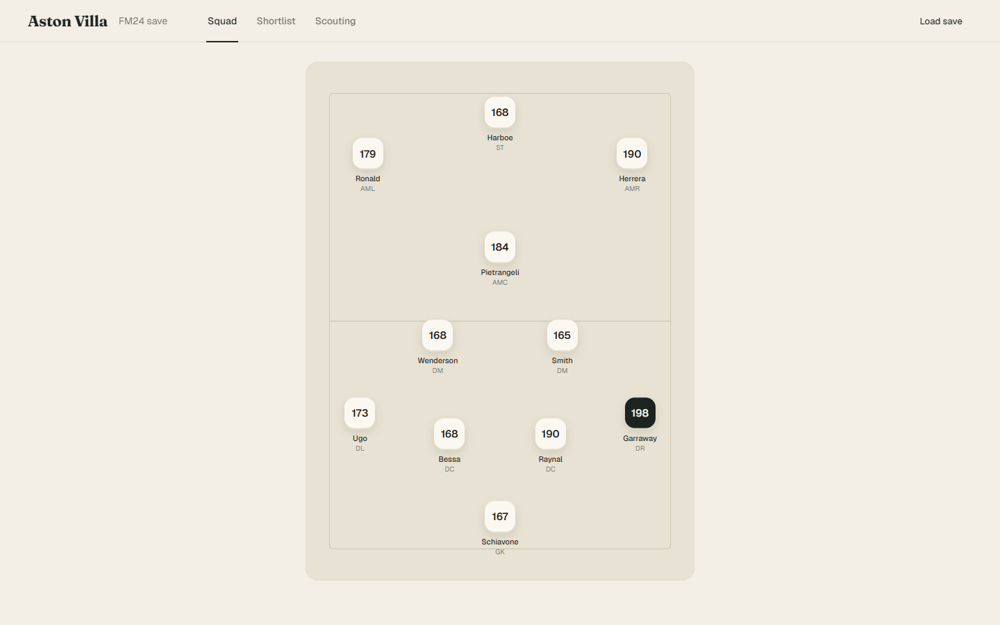
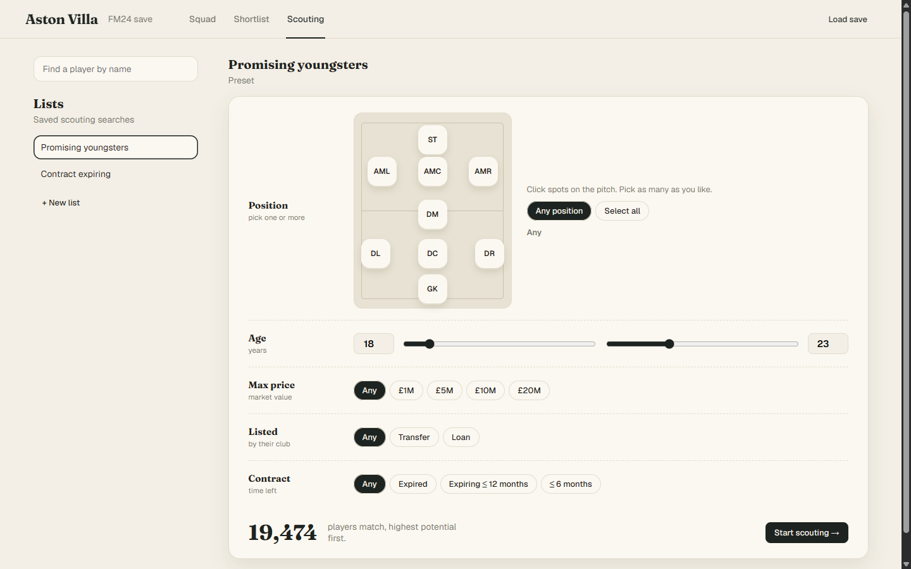
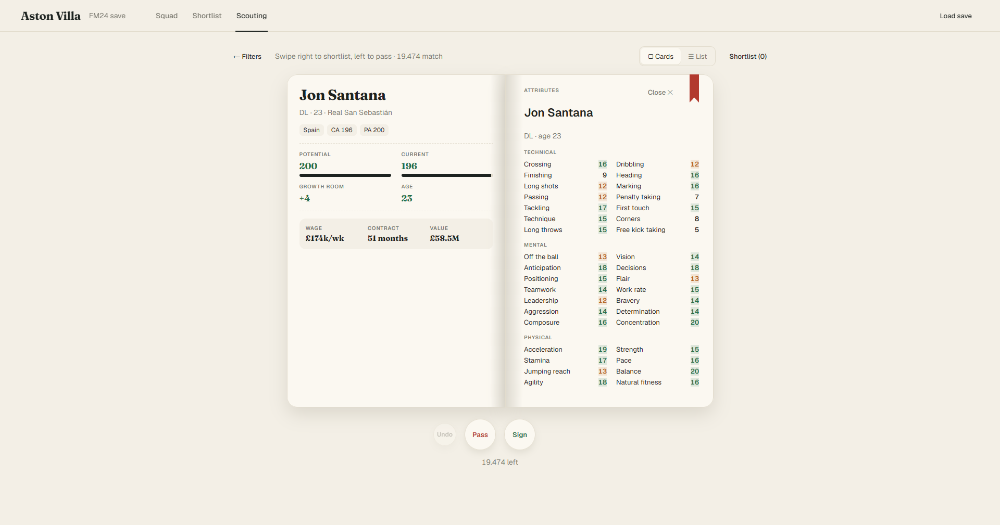

# FM Squad Planner

A local Football Manager 2024 squad planner. Load a `.fm` save, arrange your squad on a 4-2-3-1 pitch, cover every position, and find replacements. Your save never leaves your computer.

Built on [FM SaveLens 24](https://github.com/MSalman5230/FM-SaveLens-24), whose Rust parser reads the save. This repository patches it to also read wage, contract end and value. It has no licence, so keep this repository private. Supports FM24 save format **24.3.0+0**. Not affiliated with Sports Interactive or SEGA.

## Screenshots

| Squad | Scouting | Swipe |
|---|---|---|
|  |  |  |

## Features

- **Squad**: pitch with drag and drop, position depth panel, multi-position cover, add and remove players.
- **Find replacement / Add cover**: your own squad first, then outside players ranked by CA against the player replaced, tagged contract expiring or cheap.
- **Scouting**: preset lists (promising youngsters, contract expiring) and custom lists.
- **Your club** is detected from the save. Your arrangement and shortlist are stored with the save's snapshot on your computer.

## Run

Needs Node.js 24.14+ and Rust (pinned in `rust-toolchain.toml`).

```sh
npm --prefix web ci
cargo run --release --bin fm-squad-planner-server -- --no-open --port 4242
npm --prefix web run dev
```

Open [localhost:5173](http://localhost:5173). The server is API-only; Vite serves the web app and proxies `/api` to :4242.

## Desktop app

`npm run build:desktop` builds `target/release/fm-squad-planner-desktop.exe`, a single portable exe (web app embedded). Pushing a `v*` tag builds it into a draft GitHub release (`.github/workflows/release.yml`). The version comes from `src-tauri/tauri.conf.json`. Only one instance (or server) can use the data folder at a time; `FM_SQUAD_PLANNER_DATA_DIR` picks another.

## Test

```sh
cd web && npm test && npm run typecheck && npm run format:check
cargo test --release --locked
```

A pre-commit hook runs Prettier on `web/`, and the PR workflow checks format, tests and build.

## Layout

- `web/`: React 18 + TypeScript app (react-router, recoil, swr, axios). Builds to `web/dist/client`, which the desktop exe embeds.
- `src-tauri/`: Tauri desktop app; runs the server in-process and serves the embedded web app.
- `src/`: Rust parser and API server (`src/adapters/parser/contract.rs` reads wage, contract end and value).
- `CLAUDE.md`: project notes and decisions.
